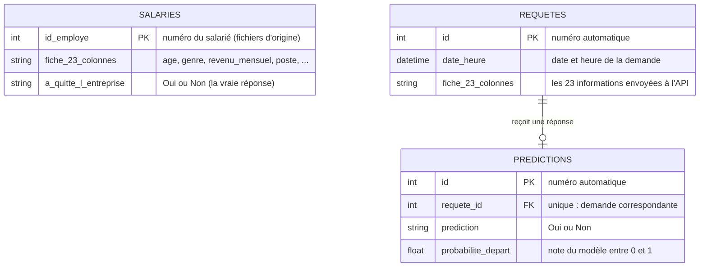

# Modèle de données (base PostgreSQL `technova`)

La base contient 3 tables. Le schéma ci-dessous s'affiche directement sur GitHub.



## Les tables

| Table | Rôle | Remplie par |
|-------|------|-------------|
| `salaries` | Les 1470 salariés du jeu de données d'entraînement, avec la vraie réponse (parti ou non). | `python -m db.charger_salaries` |
| `requetes` | Une ligne par appel de l'API : la fiche reçue (23 informations) et la date. | l'API, à chaque prédiction |
| `predictions` | Une ligne par réponse du modèle, reliée à sa demande. | l'API, à chaque prédiction |

## Les règles de la base

- Toutes les colonnes sont obligatoires (`NOT NULL`).
- Chaque colonne numérique a des bornes (par exemple `age` entre 18 et 70, `niveau_education` entre 1 et 5) et chaque colonne texte a une liste de valeurs permises : ce sont des contraintes `CHECK` nommées `ck_<table>_<colonne>`.
- Trois règles de cohérence comparent deux colonnes (par exemple `annees_dans_l_entreprise <= annee_experience_totale`).
- `predictions.requete_id` est une clé étrangère vers `requetes.id`, **unique** (une demande n'a qu'une réponse), avec suppression en cascade (supprimer une demande supprime sa réponse).
- `predictions.prediction` vaut `Oui` ou `Non`, et `probabilite_depart` est comprise entre 0 et 1.

## Créer et interroger la base

```
python -m db.create_db          # crée les 3 tables
python -m db.charger_salaries   # charge les 1470 salariés
python -m db.journal            # compte les demandes et prédictions enregistrées
python -m db.requetes           # lance les requêtes SQL d'exemple
```

## Volume des données et performance

- La table `salaries` est fixe (1470 lignes). Les tables `requetes` et `predictions` grossissent d'une ligne chacune à chaque appel de l'API : ce sont de petites lignes, et PostgreSQL gère sans difficulté le volume attendu pour un usage RH.
- Les clés primaires (`id`) et la contrainte d'unicité de `predictions.requete_id` sont indexées automatiquement par PostgreSQL : retrouver une demande et sa réponse est rapide.
- Si le volume augmentait fortement, on ajouterait un index sur `requetes.date_heure` (filtres par date), on archiverait les anciennes lignes et on ferait des sauvegardes régulières. Ce n'est pas nécessaire à ce stade et n'a pas été mis en place.

## Droits d'accès

Deux utilisateurs PostgreSQL se partagent la base :

| Utilisateur | Utilisé par | Droits |
|-------------|-------------|--------|
| `postgres` (administrateur) | `db.create_db`, `db.charger_salaries`, `db.requetes` (via `DATABASE_ADMIN_URL`) | tous |
| `technova_api` | l'API (via `DATABASE_URL`) | lire et ajouter des lignes dans `requetes` et `predictions`, utiliser leurs compteurs de numéros ; rien d'autre |

Le script `db/creer_utilisateur_api.sql` crée `technova_api`. Son mot de passe se définit à part (`\password technova_api` dans `psql`) :
il n'est jamais écrit dans le dépôt.
