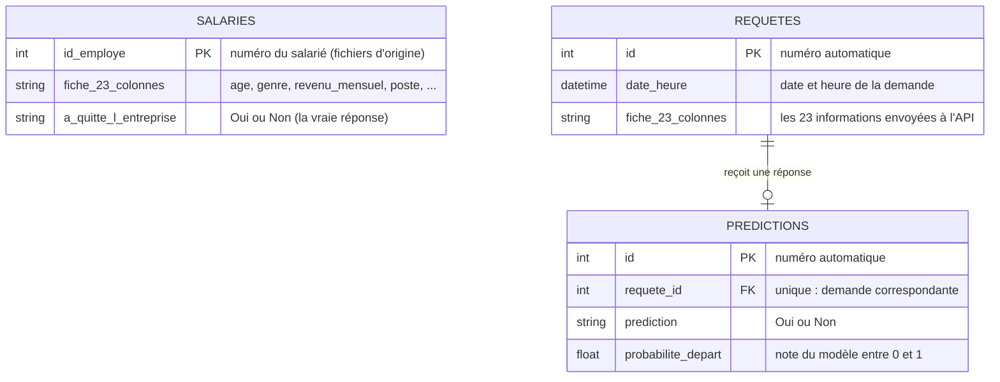

# Modèle de données (base PostgreSQL `technova`)

La base contient 3 tables. Le schéma ci-dessous s'affiche directement sur GitHub.



## Les tables

| Table | Rôle | Remplie par |
|-------|------|-------------|
| `salaries` | Les 1470 salariés du jeu de données d'entraînement, avec la vraie réponse (parti ou non). | `python -m db.charger_salaries` |
| `requetes` | Une ligne par appel de l'API : la fiche reçue (23 informations) et la date. | l'API, à chaque prédiction |
| `predictions` | Une ligne par réponse du modèle, reliée à sa demande. | l'API, à chaque prédiction |

## Les règles de la base

- Toutes les colonnes sont obligatoires (`NOT NULL`).
- Chaque colonne numérique a des bornes (par exemple `age` entre 18 et 70, `niveau_education` entre 1 et 5) et chaque colonne texte a une liste de valeurs permises : ce sont des contraintes `CHECK` nommées `ck_<table>_<colonne>`.
- Trois règles de cohérence comparent deux colonnes (par exemple `annees_dans_l_entreprise <= annee_experience_totale`).
- `predictions.requete_id` est une clé étrangère vers `requetes.id`, **unique** (une demande n'a qu'une réponse), avec suppression en cascade (supprimer une demande supprime sa réponse).
- `predictions.prediction` vaut `Oui` ou `Non`, et `probabilite_depart` est comprise entre 0 et 1.

## Créer et interroger la base

```
python -m db.create_db          # crée les 3 tables
python -m db.charger_salaries   # charge les 1470 salariés
python -m db.journal            # compte les demandes et prédictions enregistrées
python -m db.requetes           # lance les requêtes SQL d'exemple
```
